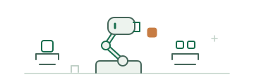

# José Carlos Malacara Espinosa

**Python Developer | Technical Consultant**\
Saltillo, Mexico

I work with Python, data, and computer vision. I like connecting software with something tangible: an image, a document, a machine, or a workflow.

## Selected work

### 01 / VECTOR UroSight

A desktop application for exploring urinary sediment images, developed from my master’s capstone work. It brings together local YOLO inference, human review of detections, and PDF, CSV, and JSON exports. The central question is how to keep image analysis traceable and open to human correction.

`Python` · `YOLO` · `PySide6` · `Computer vision`

**Status:** Experimental academic prototype with a runnable demonstration. Real inference requires separately obtained model weights. It has not been clinically validated and is not a diagnostic tool.

[Explore the project](https://github.com/DnsRudy21/VECTOR_UroSight/blob/main/README.en.md) · [Inspect the inference code](https://github.com/DnsRudy21/VECTOR_UroSight/blob/main/src/inference/local_yolo_provider.py)

### 02 / Vector PDF Suite

A local PDF workspace for batch conversion, merging, splitting, protection, and text extraction. It explores a practical concern: handling everyday document tasks without uploading files to another service. A Python API handles document operations, with React and Electron providing the desktop interface.

`Python` · `FastAPI` · `PyMuPDF` · `React` · `Electron`

**Status:** Public application source with tests and desktop build scripts. The repository documents how to run and package it locally.

[Explore the project](https://github.com/DnsRudy21/vector-pdf-suite) · [Inspect the document engine](https://github.com/DnsRudy21/vector-pdf-suite/blob/main/backend/app/converter.py)

### 03 / RobotSimulator

An educational demo with a virtual six-axis robot, a teach pendant, and exercises in programming and fault recovery. The idea is to make the logic of a robotic cell visible through practice. A C# core shares robot state across desktop and spatial interaction modes, with projects saved as local files.

`C#` · `Godot .NET` · `OpenXR` · `Robotics`

**Status:** Windows educational demo. Desktop and simulated spatial interaction are documented; the OpenXR headset path still needs hardware validation.

[Explore the project](https://github.com/DnsRudy21/RobotSimulator/blob/main/README.en.md) · [Inspect the XR adapter](https://github.com/DnsRudy21/RobotSimulator/blob/main/godot/scripts/openxr_adapter.gd)

## The thread between these projects

Different tools, similar questions: what is happening inside the system, what can a person inspect, and what happens when something goes wrong?

My background in mechatronics and clinical systems shapes that curiosity. I tend to start with the operation around the software: the people using it, the equipment involved, and the constraints that make the problem interesting.

I enjoy the space between understanding a system and building something with it. These repositories are part of that process, including their experiments, limitations, and unfinished questions.

## Tools I work with

| Purpose | Technologies |
| --- | --- |
| Build and automate | Python · SQL · REST APIs |
| Analyze data | Pandas · Scikit-learn |
| Explore vision and AI | PyTorch · OpenCV · YOLO |
| Work with systems | PostgreSQL · SQL Server · Git · Linux · CI/CD |

The mix changes with each project. Python is the common thread; robotics also takes me into C# and Godot.

## Around here

You can explore the code, read the project notes, or compare approaches. For a conversation about software, automation, or a shared technical question, you can find me on [LinkedIn](https://www.linkedin.com/in/josecarlosmalacara/).

Mechatronics habit: when something behaves strangely, check the assumptions before blaming the robot.

<picture>
  <source media="(prefers-color-scheme: dark)" srcset="./assets/workbench-dark.svg">
  <source media="(prefers-color-scheme: light)" srcset="./assets/workbench-light.svg">
  
</picture>
